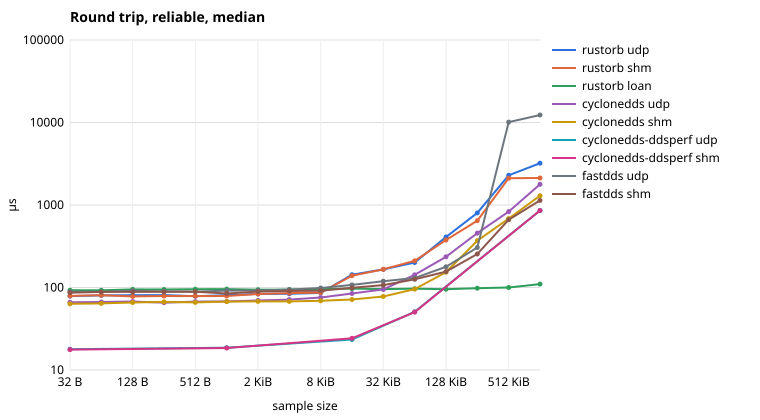
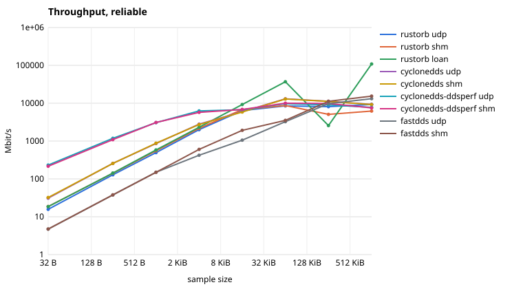

# 性能測定

rustorb-dds の往復レイテンシとスループットを、同じ機械の上で Cyclone DDS と Fast DDS と比べた（rustorb-dds#100 の段 1）。測り方の道具は [bench/](../bench/README.md) にある。

**ここの数値はコンテナで測った。** CPU 4 個を他と分け合い、周波数も割り込みも固定できないので、回ごとに揺れる。同じ実行の中での相対比較として読み、別の機械や別の実行の数値と並べないこと。公開用の数値を専用の機械で測るかどうかは、あとで決める（#100）。

## 測り方

- 3 つの実装で同じ手順のプログラムを使う。rustorb-dds は `rustorb-dds-perf`（[crates/rustorb-dds-perf](../crates/rustorb-dds-perf)）、Cyclone DDS 0.10.4 は [bench/cyclonedds/perf.c](../bench/cyclonedds/perf.c)、Fast DDS 2.11.2 は [bench/fastdds/perf.cpp](../bench/fastdds/perf.cpp)。どれも同じ型（[bench/idl/Perf.idl](../bench/idl/Perf.idl): 通し番号、時刻、`sequence<octet>`）、同じ QoS、同じ待ち方（reader に標本が来るまで待って take）で、互いにつなげられる。参考に Cyclone DDS の `ddsperf`（型 `KS`、listener で受ける）も測った。
- レイテンシ: ping が書き、pong が受けて書き返すまでの往復時間。32 B〜1 MiB（2 倍刻み）。各大きさで 0.5 秒の warm-up のあと 2 秒。reliable は KEEP_LAST 1。
- スループット: pub が全力で書き、sub が 2 秒で受けた payload。reliable は writer が KEEP_ALL で未確認応答 100 標本まで（溢れると write が待つ）、best-effort は待たない。
- 転送: `udp`（rustorb-dds と Fast DDS は共有メモリを切る。Cyclone DDS の既定）、`shm`（rustorb-dds の共有メモリ、Fast DDS の既定の組み込み転送、Cyclone DDS の iceoryx）、`loan`（rustorb-dds の貸し出し: payload に触れない zero-copy）。実装をまたぐ組は `udp` だけ。
- 2 つのプロセスを CPU の半分ずつに固定した。各組を 3 回測り、中央値を載せる。CPU 時間と最大 RSS は両方のプロセスの `wait4` から取った。

再現:

```sh
bench/run.py --interop --kinds latency --warmup 0.5 --duration 2 --repeat 3 --out bench/results/<名前>
bench/run.py --interop --kinds throughput --warmup 0.5 --duration 2 --repeat 3 --out bench/results/<名前>
bench/report.py bench/results/<名前> --svg docs/benchmark
```

この文書の数値は [bench/results/2026-11-26-container](../bench/results/2026-11-26-container)（rustorb-dds 771410f、Intel Xeon 2.10GHz 4 CPU のコンテナ、Linux 6.18）。

## わかったこと

レイテンシ（reliable の往復、中央値）:



- 小さな標本で、rustorb-dds は Cyclone DDS の約 2 倍、Fast DDS の約 1.5 倍かかる（32 B: rustorb 123 µs、Cyclone 65 µs、Fast DDS 81 µs）。rustorb と Cyclone の組では 80 µs で、rustorb の側だけで 40〜60 µs 余分にかかっている。→ #111
- rustorb-dds の共有メモリは往復を速くしない（32 B で 128 µs、64 KiB で 239 µs。UDP は 123 µs、222 µs）。→ #111
- 貸し出し（zero-copy）は大きさによらず 140〜156 µs で、1 MiB でも UDP（2.9 ms）の 1/18。
- 128 KiB を超えると rustorb-dds の往復が急に伸びる（256 KiB: rustorb 1.3 ms、Cyclone 0.45 ms、Fast DDS 0.25 ms）。→ #112
- Cyclone の ddsperf は 17 µs。listener の中で返事を書くので、待っているスレッドを起こす手順がない。上の 3 つのプログラムとは手順が違う。
- Fast DDS は best-effort で 256 KiB 以上（rustorb との組でも）の往復が全部失われ、reliable の 512 KiB 以上で 99 パーセンタイルが数百 ms になった。Fast DDS 2.11 の UDP での大きな標本の扱いと思われる（相手は black box なので確かめていない）。

スループット（reliable）:



- 小さな標本で rustorb-dds は Cyclone DDS の約 6 割（1 KiB: 495 Mbit/s と 858 Mbit/s）。Fast DDS（150 Mbit/s）よりは速い。ddsperf は 3 Gbit/s。→ #113
- 64 KiB で rustorb 8.5 Gbit/s、Cyclone 13 Gbit/s。貸し出しは 37 Gbit/s。
- 256 KiB 以上で rustorb-dds の共有メモリが UDP より遅く、貸し出しの 256 KiB は 2.6 Gbit/s に落ちる（回ごとの揺れも大きい）。→ #112

best-effort:

- 全力で送ると、rustorb-dds の受け手の最大 RSS が 1.9 GB（rustorb → rustorb、UDP）、2.7 GB（Fast DDS → rustorb）まで増えた。受け取ったが処理していないものが際限なく溜まっている。1 回は 90 秒の間に 1 標本も受け取れなかった（Fast DDS → rustorb、256 KiB）。→ #110
  - 2026-11-26 調べた結果: 溜まっていたのは KEEP_ALL で上限のない reader の history（QoS どおり）で、rustorb-dds の sub が送り手より遅いため。測定ツールの sub はそれを一度に全部 take していた。今は rustorb-dds の sub も Cyclone DDS 版と同じく 256 標本ずつ take し、3 実装とも best-effort の sub は take していない標本を 1000 までにしている（入らない分は lost）。受信 queue にも上限を設けた。この表の数値はその前のもの。
- 取りこぼし数は送り手の速さで決まるので、実装どうしの比較には向かない（表は下に載せる）。

測っている途中で、速い writer が受け手の共有メモリの ring を溢れさせると write が「the shared memory buffer is full」で失敗する不具合が見つかり、直した（ring に入らないメッセージは UDP で失われたのと同じ扱い。docs/shm.md のとおり）。

## 結果の表

`bench/report.py` の出力。列は実装と転送。2 つの実装の組は、レイテンシでは「ping↔pong」、スループットでは「pub→sub」。「lost」はすべての往復が失われたもの、「–」は測っていないもの。

### Latency, reliable: round trip, median (µs)

| size | rustorb udp | rustorb shm | rustorb loan | cyclonedds udp | cyclonedds shm | cyclonedds-ddsperf udp | cyclonedds-ddsperf shm | fastdds udp | fastdds shm | rustorb↔cyclonedds udp | rustorb↔fastdds udp | cyclonedds↔rustorb udp | fastdds↔rustorb udp |
|---:|---:|---:|---:|---:|---:|---:|---:|---:|---:|---:|---:|---:|---:|
| 32 B | 122.9 | 127.5 | 141.3 | 64.8 | 62.0 | 18.5 | 16.5 | 80.5 | 86.6 | 80.1 | 102.1 | 79.3 | 105.0 |
| 64 B | 118.2 | 127.1 | 138.6 | 65.1 | 59.7 | – | – | 82.7 | 85.4 | 83.0 | 101.6 | 82.1 | 112.3 |
| 128 B | 120.4 | 127.8 | 142.7 | 65.2 | 60.9 | – | – | 83.3 | 89.0 | 83.5 | 100.8 | 78.4 | 108.4 |
| 256 B | 121.0 | 128.9 | 141.5 | 66.0 | 61.0 | – | – | 82.3 | 86.5 | 80.2 | 103.3 | 84.1 | 110.3 |
| 512 B | 120.9 | 132.8 | 140.7 | 68.6 | 62.8 | – | – | 85.0 | 88.3 | 83.4 | 101.7 | 81.8 | 110.8 |
| 1 KiB | 122.8 | 130.1 | 143.4 | 67.8 | 62.7 | 17.3 | 17.4 | 83.4 | 85.2 | 91.4 | 104.4 | 86.0 | 110.8 |
| 2 KiB | 126.3 | 132.4 | 141.8 | 68.4 | 64.2 | – | – | 85.3 | 87.8 | 85.4 | 104.1 | 83.3 | 111.6 |
| 4 KiB | 126.6 | 140.5 | 145.0 | 68.5 | 65.1 | – | – | 84.0 | 88.6 | 84.5 | 109.1 | 82.3 | 113.1 |
| 8 KiB | 130.8 | 138.3 | 144.8 | 73.0 | 63.6 | – | – | 87.0 | 89.9 | 93.4 | 113.6 | 86.2 | 115.8 |
| 16 KiB | 139.6 | 144.7 | 139.9 | 82.6 | 66.6 | 22.7 | 22.7 | 94.1 | 97.2 | 115.2 | 123.3 | 109.2 | 128.2 |
| 32 KiB | 165.3 | 170.1 | 143.6 | 94.9 | 72.9 | – | – | 107.9 | 103.3 | 130.2 | 138.2 | 137.1 | 143.4 |
| 64 KiB | 222.2 | 238.8 | 139.3 | 134.2 | 87.7 | 47.0 | 47.3 | 114.6 | 113.8 | 183.4 | 167.1 | 189.8 | 174.0 |
| 128 KiB | 396.4 | 477.5 | 142.3 | 221.9 | 146.3 | – | – | 151.3 | 138.4 | 271.0 | 258.0 | 462.9 | 258.2 |
| 256 KiB | 1,281 | 1,292 | 146.2 | 451.9 | 349.1 | – | – | 249.1 | 239.9 | 828.0 | 680.7 | 858.6 | 705.5 |
| 512 KiB | 2,537 | 2,546 | 150.4 | 799.5 | 596.3 | – | – | 812.4 | 559.0 | 1,461 | 2,016 | 1,583 | 1,185 |
| 1 MiB | 2,862 | 3,093 | 156.4 | 1,895 | 1,247 | 734.2 | 883.4 | 8,180 | 983.9 | 3,181 | 5,681 | 2,571 | 6,620 |

In this table the runs of a cell differed by 6 % (median over the cells), 643 % at most.

### Latency, reliable: round trip, 99th percentile (µs)

| size | rustorb udp | rustorb shm | rustorb loan | cyclonedds udp | cyclonedds shm | cyclonedds-ddsperf udp | cyclonedds-ddsperf shm | fastdds udp | fastdds shm | rustorb↔cyclonedds udp | rustorb↔fastdds udp | cyclonedds↔rustorb udp | fastdds↔rustorb udp |
|---:|---:|---:|---:|---:|---:|---:|---:|---:|---:|---:|---:|---:|---:|
| 32 B | 200.7 | 213.2 | 262.1 | 126.5 | 114.7 | 38.7 | 37.7 | 134.1 | 197.1 | 146.2 | 189.9 | 147.4 | 217.2 |
| 64 B | 222.8 | 222.2 | 227.2 | 123.0 | 111.8 | – | – | 145.4 | 170.3 | 146.5 | 200.1 | 168.9 | 221.9 |
| 128 B | 202.1 | 220.2 | 276.0 | 139.2 | 110.9 | – | – | 144.5 | 197.2 | 153.1 | 181.2 | 165.1 | 202.7 |
| 256 B | 231.0 | 214.9 | 230.8 | 130.2 | 104.5 | – | – | 143.5 | 176.8 | 149.6 | 186.2 | 170.5 | 213.8 |
| 512 B | 266.8 | 236.7 | 243.7 | 135.9 | 137.1 | – | – | 156.1 | 163.8 | 159.6 | 187.5 | 175.6 | 230.9 |
| 1 KiB | 208.7 | 224.6 | 251.1 | 143.1 | 115.6 | 36.6 | 36.1 | 146.6 | 173.0 | 181.2 | 255.4 | 164.1 | 218.0 |
| 2 KiB | 224.5 | 221.9 | 251.5 | 146.2 | 114.9 | – | – | 156.1 | 170.2 | 168.4 | 189.4 | 156.8 | 225.0 |
| 4 KiB | 233.5 | 240.8 | 264.3 | 141.6 | 120.9 | – | – | 148.7 | 183.3 | 167.7 | 235.7 | 165.3 | 239.2 |
| 8 KiB | 226.0 | 291.7 | 235.9 | 157.5 | 111.0 | – | – | 158.1 | 174.0 | 183.1 | 237.6 | 163.6 | 220.4 |
| 16 KiB | 261.6 | 249.9 | 256.9 | 159.4 | 119.5 | 57.3 | 53.9 | 186.1 | 176.8 | 219.7 | 246.8 | 196.4 | 268.4 |
| 32 KiB | 267.6 | 331.0 | 245.9 | 192.9 | 129.4 | – | – | 186.1 | 186.9 | 226.2 | 285.0 | 245.8 | 282.4 |
| 64 KiB | 336.6 | 444.2 | 228.1 | 240.9 | 154.0 | 118.8 | 101.8 | 197.0 | 223.9 | 317.4 | 334.9 | 381.0 | 376.1 |
| 128 KiB | 812.6 | 909.3 | 241.1 | 422.6 | 244.8 | – | – | 280.3 | 296.2 | 511.5 | 557.1 | 832.0 | 568.0 |
| 256 KiB | 1,810 | 2,087 | 242.2 | 1,082 | 578.3 | – | – | 1,248 | 524.4 | 1,179 | 6,240 | 1,493 | 6,287 |
| 512 KiB | 3,807 | 3,497 | 267.8 | 1,387 | 913.7 | – | – | 32,517 | 11,170 | 2,263 | 399,774 | 2,528 | 359,822 |
| 1 MiB | 4,149 | 4,893 | 279.0 | 3,665 | 1,632 | 1,135 | 1,446 | 43,047 | 22,184 | 4,708 | 401,128 | 3,924 | 400,433 |

In this table the runs of a cell differed by 17 % (median over the cells), 763 % at most.

### Throughput, reliable (Mbit/s of payload received)

| size | rustorb udp | rustorb shm | rustorb loan | cyclonedds udp | cyclonedds shm | cyclonedds-ddsperf udp | cyclonedds-ddsperf shm | fastdds udp | fastdds shm | rustorb→cyclonedds udp | rustorb→fastdds udp | cyclonedds→rustorb udp | fastdds→rustorb udp |
|---:|---:|---:|---:|---:|---:|---:|---:|---:|---:|---:|---:|---:|---:|
| 32 B | 15.7 | 18.7 | 18.5 | 30.9 | 32.3 | 232.3 | 215.8 | 4.7 | 4.7 | 26.6 | 4.6 | 68.6 | 11.4 |
| 256 B | 128.6 | 140.9 | 142.8 | 257.8 | 256.7 | 1,184 | 1,094 | 37.7 | 37.8 | 222.1 | 36.6 | 461.1 | 91.8 |
| 1 KiB | 495.1 | 551.0 | 581.9 | 858.4 | 878.6 | 3,072 | 3,101 | 149.9 | 149.5 | 839.6 | 144.7 | 1,595 | 363.4 |
| 4 KiB | 2,008 | 2,171 | 2,317 | 2,804 | 2,736 | 6,258 | 5,734 | 422.9 | 601.7 | 3,234 | 292.0 | 4,531 | 1,367 |
| 16 KiB | 6,387 | 6,799 | 9,224 | 5,974 | 5,857 | 6,733 | 6,823 | 1,057 | 1,920 | 8,721 | 682.6 | 8,174 | 4,974 |
| 64 KiB | 8,508 | 8,663 | 36,857 | 13,068 | 12,923 | 9,696 | 10,021 | 3,256 | 3,519 | 5,057 | 476.6 | 6,995 | 10,569 |
| 256 KiB | 8,125 | 5,083 | 2,565 | 11,242 | 11,146 | 9,042 | 9,830 | 9,763 | 11,239 | 11,867 | 672.1 | 9,771 | 8,011 |
| 1 MiB | 9,261 | 6,216 | 108,582 | 9,299 | 9,215 | 7,737 | 7,522 | 13,158 | 15,372 | 3,125 | 7,072 | 13,615 | 5,985 |

In this table the runs of a cell differed by 7 % (median over the cells), 5273 % at most.

### Latency, best-effort: round trip, median (µs)

| size | rustorb udp | rustorb shm | rustorb loan | cyclonedds udp | cyclonedds shm | cyclonedds-ddsperf udp | cyclonedds-ddsperf shm | fastdds udp | fastdds shm | rustorb↔cyclonedds udp | rustorb↔fastdds udp | cyclonedds↔rustorb udp | fastdds↔rustorb udp |
|---:|---:|---:|---:|---:|---:|---:|---:|---:|---:|---:|---:|---:|---:|
| 32 B | 100.2 | 104.5 | 112.8 | 62.6 | 60.6 | 16.9 | 16.1 | 65.5 | 66.3 | 79.4 | 81.9 | 78.1 | 83.5 |
| 64 B | 101.0 | 106.8 | 115.7 | 63.2 | 58.9 | – | – | 66.4 | 65.6 | 80.0 | 80.8 | 78.9 | 84.5 |
| 128 B | 102.4 | 107.4 | 114.3 | 63.1 | 59.8 | – | – | 65.2 | 65.8 | 80.5 | 82.1 | 78.0 | 84.7 |
| 256 B | 99.8 | 106.4 | 114.4 | 65.5 | 62.2 | – | – | 66.4 | 64.1 | 81.7 | 82.8 | 78.1 | 84.5 |
| 512 B | 101.5 | 107.0 | 112.8 | 65.7 | 59.7 | – | – | 65.8 | 67.0 | 80.2 | 83.3 | 78.3 | 80.9 |
| 1 KiB | 103.9 | 106.4 | 114.3 | 66.5 | 60.0 | 18.0 | 16.7 | 65.9 | 69.0 | 81.6 | 83.0 | 79.7 | 85.5 |
| 2 KiB | 105.7 | 110.9 | 116.9 | 66.3 | 63.0 | – | – | 68.4 | 66.6 | 81.7 | 88.7 | 80.9 | 86.0 |
| 4 KiB | 108.4 | 110.0 | 118.7 | 66.7 | 64.7 | – | – | 69.0 | 67.9 | 83.5 | 86.0 | 79.8 | 88.4 |
| 8 KiB | 111.6 | 115.7 | 115.5 | 69.6 | 64.5 | – | – | 71.2 | 72.7 | 86.7 | 92.5 | 85.0 | 92.3 |
| 16 KiB | 119.7 | 122.7 | 119.1 | 80.4 | 66.6 | 21.0 | 23.1 | 75.1 | 77.9 | 94.1 | 96.2 | 92.9 | 101.3 |
| 32 KiB | 140.6 | 148.5 | 121.1 | 87.3 | 74.9 | – | – | 87.4 | 89.0 | 109.3 | 114.7 | 115.3 | 120.2 |
| 64 KiB | 189.5 | 191.1 | 118.6 | 130.2 | 86.4 | 45.7 | 45.7 | 114.0 | 104.4 | 141.1 | 155.4 | 159.3 | 173.3 |
| 128 KiB | 465.3 | 355.8 | 120.7 | 213.4 | 145.4 | – | – | 147.3 | 133.6 | 212.3 | 213.8 | 329.2 | 467.3 |
| 256 KiB | 1,132 | 1,144 | 124.3 | 440.0 | 313.2 | – | – | lost | 221.6 | 773.2 | lost | 775.6 | lost |
| 512 KiB | 2,177 | 2,242 | 123.4 | 750.2 | 608.2 | – | – | lost | lost | 1,482 | lost | 1,478 | lost |
| 1 MiB | 3,208 | 2,708 | 124.9 | 2,405 | 1,242 | 788.6 | 878.2 | lost | lost | 3,016 | lost | 3,256 | lost |

In this table the runs of a cell differed by 5 % (median over the cells), 51 % at most.

### Latency, best-effort: round trip, 99th percentile (µs)

| size | rustorb udp | rustorb shm | rustorb loan | cyclonedds udp | cyclonedds shm | cyclonedds-ddsperf udp | cyclonedds-ddsperf shm | fastdds udp | fastdds shm | rustorb↔cyclonedds udp | rustorb↔fastdds udp | cyclonedds↔rustorb udp | fastdds↔rustorb udp |
|---:|---:|---:|---:|---:|---:|---:|---:|---:|---:|---:|---:|---:|---:|
| 32 B | 183.9 | 195.1 | 186.7 | 120.5 | 119.8 | 35.1 | 36.6 | 117.1 | 136.3 | 153.3 | 169.7 | 146.6 | 175.3 |
| 64 B | 195.2 | 192.0 | 219.0 | 119.5 | 113.2 | – | – | 131.7 | 121.8 | 179.6 | 153.2 | 143.6 | 171.7 |
| 128 B | 201.4 | 233.5 | 189.5 | 121.7 | 108.5 | – | – | 125.8 | 123.1 | 145.9 | 161.3 | 169.7 | 180.6 |
| 256 B | 180.0 | 196.1 | 224.6 | 147.6 | 117.7 | – | – | 127.6 | 118.8 | 158.1 | 177.8 | 142.0 | 171.1 |
| 512 B | 179.1 | 198.5 | 183.6 | 134.8 | 105.4 | – | – | 124.0 | 124.4 | 159.2 | 189.5 | 153.7 | 163.9 |
| 1 KiB | 173.7 | 204.8 | 198.3 | 134.7 | 109.1 | 37.8 | 34.3 | 145.5 | 133.9 | 162.4 | 158.5 | 150.3 | 177.1 |
| 2 KiB | 191.7 | 217.2 | 200.7 | 127.8 | 115.1 | – | – | 138.9 | 129.5 | 148.4 | 192.7 | 149.9 | 173.9 |
| 4 KiB | 194.1 | 213.5 | 197.5 | 124.8 | 116.5 | – | – | 131.1 | 134.0 | 158.9 | 186.3 | 133.6 | 179.4 |
| 8 KiB | 208.0 | 198.5 | 208.0 | 154.0 | 114.3 | – | – | 128.4 | 154.2 | 146.4 | 199.3 | 144.4 | 178.8 |
| 16 KiB | 218.7 | 215.4 | 208.0 | 182.8 | 120.7 | 49.7 | 52.7 | 125.3 | 154.2 | 192.0 | 202.9 | 159.5 | 208.4 |
| 32 KiB | 234.1 | 302.0 | 207.6 | 164.1 | 130.0 | – | – | 150.4 | 158.0 | 199.7 | 250.3 | 190.8 | 243.4 |
| 64 KiB | 384.6 | 389.2 | 242.5 | 240.0 | 144.8 | 96.7 | 103.3 | 235.6 | 184.9 | 263.4 | 319.2 | 350.8 | 351.5 |
| 128 KiB | 811.2 | 700.5 | 211.5 | 350.9 | 260.7 | – | – | 333.1 | 221.4 | 435.6 | 539.0 | 581.5 | 851.7 |
| 256 KiB | 1,851 | 1,853 | 240.4 | 770.7 | 519.0 | – | – | lost | 429.3 | 1,263 | lost | 1,268 | lost |
| 512 KiB | 3,253 | 3,291 | 223.1 | 1,136 | 883.8 | – | – | lost | lost | 2,469 | lost | 2,177 | lost |
| 1 MiB | 5,508 | 4,325 | 207.1 | 4,340 | 1,794 | 1,479 | 1,382 | lost | lost | 4,908 | lost | 4,573 | lost |

In this table the runs of a cell differed by 15 % (median over the cells), 74 % at most.

### Throughput, best-effort (Mbit/s of payload received)

| size | rustorb udp | rustorb shm | rustorb loan | cyclonedds udp | cyclonedds shm | cyclonedds-ddsperf udp | cyclonedds-ddsperf shm | fastdds udp | fastdds shm | rustorb→cyclonedds udp | rustorb→fastdds udp | cyclonedds→rustorb udp | fastdds→rustorb udp |
|---:|---:|---:|---:|---:|---:|---:|---:|---:|---:|---:|---:|---:|---:|
| 32 B | 52.3 | 47.7 | 37.6 | 34.4 | 17.9 | 303.5 | 301.8 | 18.3 | 17.0 | 36.5 | 17.7 | 27.4 | 61.3 |
| 256 B | 404.8 | 402.3 | 291.9 | 267.8 | 173.0 | 2,477 | 2,414 | 164.4 | 133.2 | 267.1 | 127.0 | 249.9 | 493.5 |
| 1 KiB | 1,515 | 1,374 | 1,128 | 828.2 | 601.0 | 6,823 | 6,418 | 628.6 | 503.9 | 863.8 | 480.2 | 1,083 | 1,602 |
| 4 KiB | 3,183 | 6,220 | 4,600 | 2,799 | 1,973 | 10,912 | 10,748 | 2,484 | 1,996 | 2,775 | 1,487 | 3,222 | 4,435 |
| 16 KiB | 8,019 | 6,991 | 18,908 | 7,439 | 6,304 | 10,207 | 10,212 | 7,559 | 6,929 | 10,538 | 6,259 | 6,689 | 8,603 |
| 64 KiB | 6,695 | 7,393 | 72,714 | 12,551 | 10,356 | 16,156 | 16,585 | 14,562 | 13,896 | 11,674 | 8,962 | 8,162 | 9,569 |
| 256 KiB | 9,104 | 7,305 | 297,962 | 15,428 | 13,158 | 20,338 | 19,617 | 23,189 | 20,752 | 12,384 | 13,300 | 8,281 | 8,335 |
| 1 MiB | 10,947 | 11,698 | 1,244,005 | 13,233 | 11,752 | 7,927 | 8,243 | 18,770 | 20,024 | 11,459 | 2,840 | 6,287 | 9,118 |

In this table the runs of a cell differed by 9 % (median over the cells), 112 % at most.

Samples lost, best-effort:

| size | rustorb udp | rustorb shm | rustorb loan | cyclonedds udp | cyclonedds shm | cyclonedds-ddsperf udp | cyclonedds-ddsperf shm | fastdds udp | fastdds shm | rustorb→cyclonedds udp | rustorb→fastdds udp | cyclonedds→rustorb udp | fastdds→rustorb udp |
|---:|---:|---:|---:|---:|---:|---:|---:|---:|---:|---:|---:|---:|---:|
| 32 B | 0 | 0 | 39583 | 11936 | 0 | 1079881 | 1178814 | 565687 | 267496 | 302240 | 376468 | 0 | 0 |
| 256 B | 0 | 0 | 46171 | 85492 | 779 | 219814 | 375977 | 505807 | 255713 | 302034 | 374196 | 0 | 0 |
| 1 KiB | 0 | 0 | 44099 | 119912 | 1566 | 185406 | 188357 | 510703 | 501411 | 298552 | 352372 | 0 | 0 |
| 4 KiB | 21416 | 69921 | 35568 | 157239 | 5261 | 14913 | 14097 | 428015 | 700409 | 279200 | 252892 | 0 | 58897 |
| 16 KiB | 30637 | 57721 | 47896 | 14479 | 509 | 2866 | 546 | 274371 | 386739 | 139202 | 201989 | 822 | 83284 |
| 64 KiB | 9885 | 16875 | 44716 | 720 | 46 | 348 | 335 | 71772 | 89999 | 716 | 17703 | 9464 | 29254 |
| 256 KiB | 2966 | 20 | 48763 | 330 | 65 | 90 | 309 | 5239 | 19385 | 232 | 480 | 7614 | 10072 |
| 1 MiB | 429 | 780 | 74665 | 1686 | 167 | 5027 | 5210 | 1198 | 416 | 86 | 2287 | 2220 | 1346 |

### CPU time and memory, latency runs

| case | CPU s (measuring side) | CPU s (other side) | max RSS MiB (measuring) | max RSS MiB (other) |
|---|---:|---:|---:|---:|
| cyclonedds shm best-effort | 16.4 | 21.3 | 15.4 | 15.3 |
| cyclonedds shm reliable | 16.4 | 21.2 | 15.3 | 15.3 |
| cyclonedds udp best-effort | 19.6 | 20.3 | 13.5 | 13.0 |
| cyclonedds udp reliable | 20.0 | 20.2 | 14.5 | 14.0 |
| cyclonedds-ddsperf shm best-effort | 1.5 | 1.6 | 13.0 | 13.0 |
| cyclonedds-ddsperf shm reliable | 1.7 | 1.6 | 13.0 | 13.0 |
| cyclonedds-ddsperf udp best-effort | 1.7 | 1.6 | 13.0 | 13.0 |
| cyclonedds-ddsperf udp reliable | 1.6 | 1.6 | 13.0 | 13.0 |
| cyclonedds↔rustorb udp best-effort | 14.6 | 26.0 | 13.4 | 13.3 |
| cyclonedds↔rustorb udp reliable | 18.4 | 28.1 | 13.1 | 13.9 |
| fastdds shm best-effort | 17.2 | 17.1 | 22.6 | 20.8 |
| fastdds shm reliable | 24.9 | 24.8 | 23.5 | 21.6 |
| fastdds udp best-effort | 15.6 | 15.5 | 20.2 | 17.1 |
| fastdds udp reliable | 23.6 | 23.4 | 21.8 | 19.8 |
| fastdds↔rustorb udp best-effort | 12.2 | 18.5 | 21.3 | 13.3 |
| fastdds↔rustorb udp reliable | 19.3 | 20.0 | 21.9 | 15.4 |
| rustorb loan best-effort | 17.5 | 21.5 | 20.1 | 20.1 |
| rustorb loan reliable | 24.7 | 27.8 | 20.0 | 20.1 |
| rustorb shm best-effort | 19.3 | 20.0 | 21.7 | 21.9 |
| rustorb shm reliable | 24.8 | 24.3 | 21.9 | 21.9 |
| rustorb udp best-effort | 19.2 | 19.9 | 13.9 | 13.9 |
| rustorb udp reliable | 24.8 | 24.9 | 13.9 | 13.9 |
| rustorb↔cyclonedds udp best-effort | 25.3 | 15.6 | 13.8 | 13.1 |
| rustorb↔cyclonedds udp reliable | 27.3 | 20.0 | 13.0 | 13.0 |
| rustorb↔fastdds udp best-effort | 18.3 | 12.7 | 13.0 | 17.1 |
| rustorb↔fastdds udp reliable | 19.5 | 19.4 | 15.2 | 20.0 |

### CPU time and memory, throughput runs

| case | CPU s (measuring side) | CPU s (other side) | max RSS MiB (measuring) | max RSS MiB (other) |
|---|---:|---:|---:|---:|
| cyclonedds shm best-effort | 2.1 | 2.9 | 13.0 | 13.0 |
| cyclonedds shm reliable | 2.5 | 1.2 | 13.0 | 13.0 |
| cyclonedds udp best-effort | 2.8 | 3.0 | 13.0 | 13.0 |
| cyclonedds udp reliable | 2.5 | 1.2 | 13.0 | 13.0 |
| cyclonedds-ddsperf shm best-effort | 3.3 | 5.9 | 13.1 | 13.1 |
| cyclonedds-ddsperf shm reliable | 2.0 | 3.5 | 13.1 | 13.1 |
| cyclonedds-ddsperf udp best-effort | 3.2 | 5.9 | 13.1 | 13.1 |
| cyclonedds-ddsperf udp reliable | 2.1 | 5.2 | 13.1 | 13.1 |
| cyclonedds→rustorb udp best-effort | 3.2 | 3.0 | 57.8 | 13.1 |
| cyclonedds→rustorb udp reliable | 3.5 | 2.1 | 13.3 | 13.1 |
| fastdds shm best-effort | 2.7 | 2.5 | 21.7 | 17.4 |
| fastdds shm reliable | 0.8 | 0.7 | 18.2 | 17.4 |
| fastdds udp best-effort | 2.9 | 2.5 | 18.4 | 16.1 |
| fastdds udp reliable | 0.8 | 0.8 | 16.6 | 16.3 |
| fastdds→rustorb udp best-effort | 6.3 | 3.3 | 2,704 | 16.0 |
| fastdds→rustorb udp reliable | 2.8 | 2.8 | 13.1 | 16.6 |
| rustorb loan best-effort | 3.0 | 2.5 | 13.0 | 13.0 |
| rustorb loan reliable | 2.9 | 3.2 | 13.2 | 14.2 |
| rustorb shm best-effort | 3.7 | 2.6 | 454.9 | 13.0 |
| rustorb shm reliable | 3.1 | 3.1 | 16.6 | 14.2 |
| rustorb udp best-effort | 4.8 | 2.7 | 1,907 | 13.0 |
| rustorb udp reliable | 3.3 | 3.1 | 13.0 | 13.0 |
| rustorb→cyclonedds udp best-effort | 2.8 | 2.5 | 13.1 | 13.1 |
| rustorb→cyclonedds udp reliable | 3.2 | 2.8 | 13.1 | 13.1 |
| rustorb→fastdds udp best-effort | 2.9 | 2.5 | 34.2 | 12.9 |
| rustorb→fastdds udp reliable | 0.7 | 0.4 | 20.7 | 12.9 |
